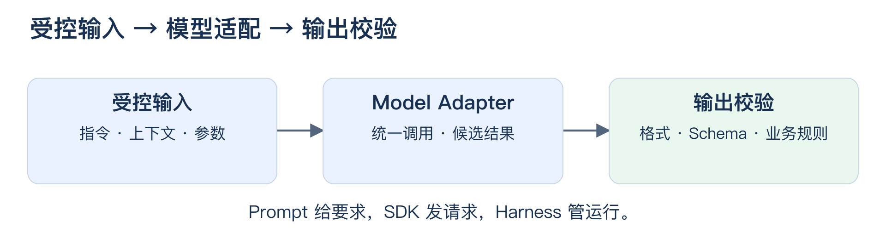
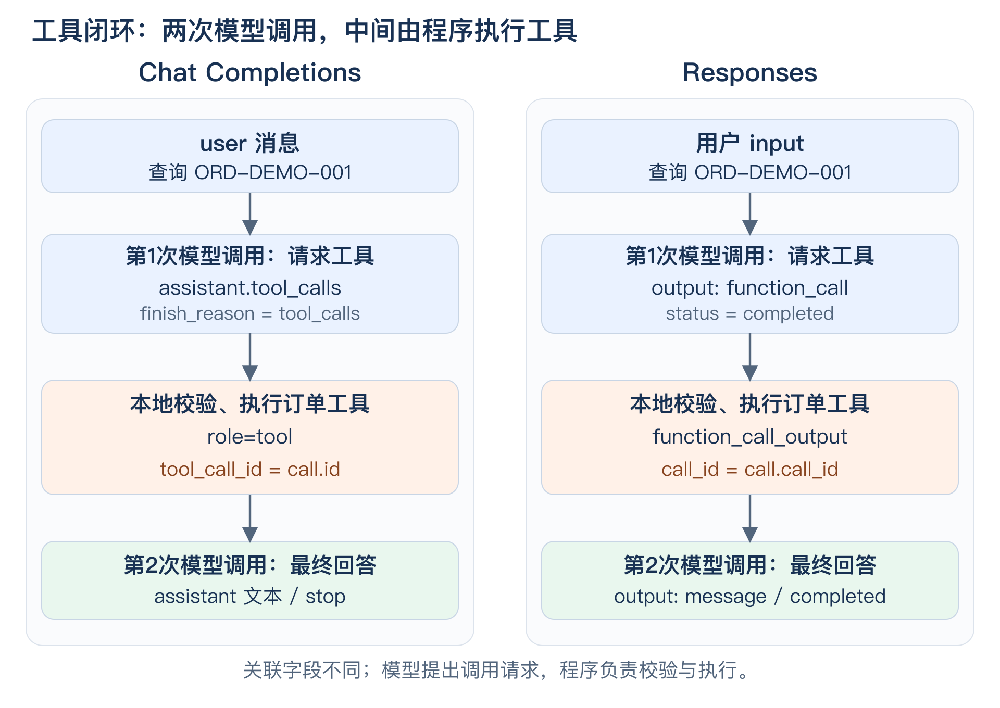
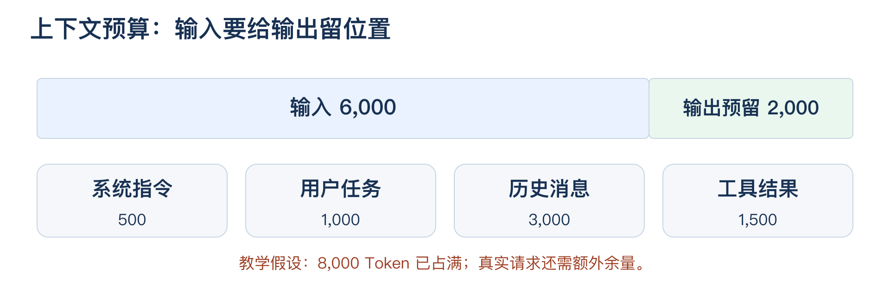
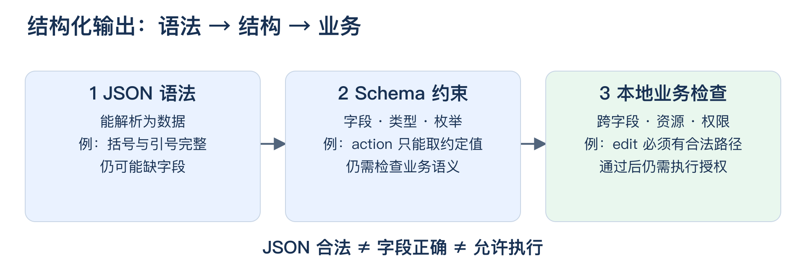
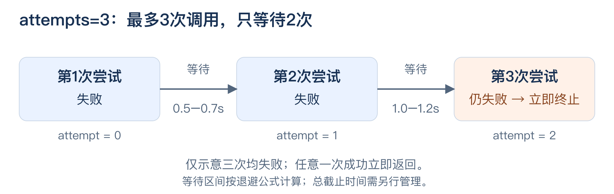
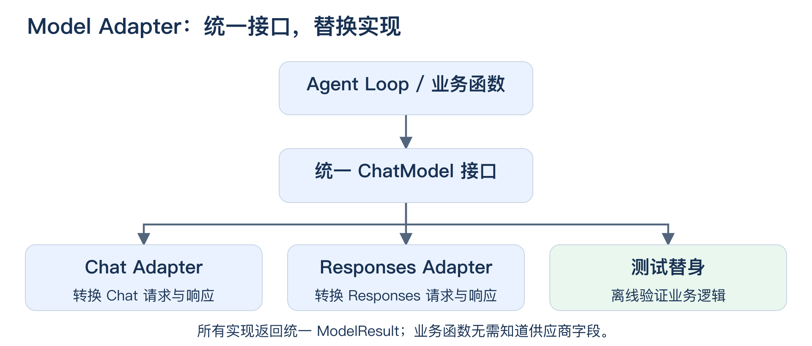
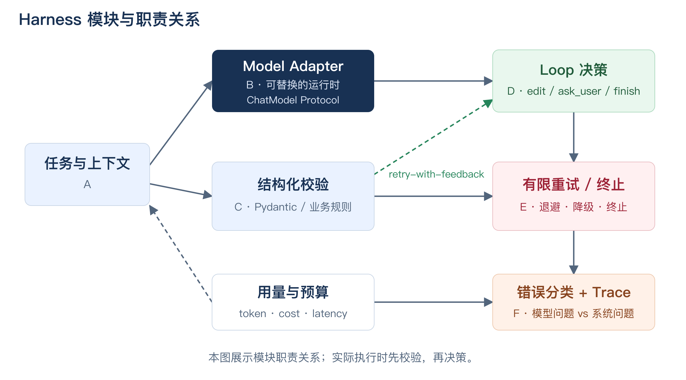
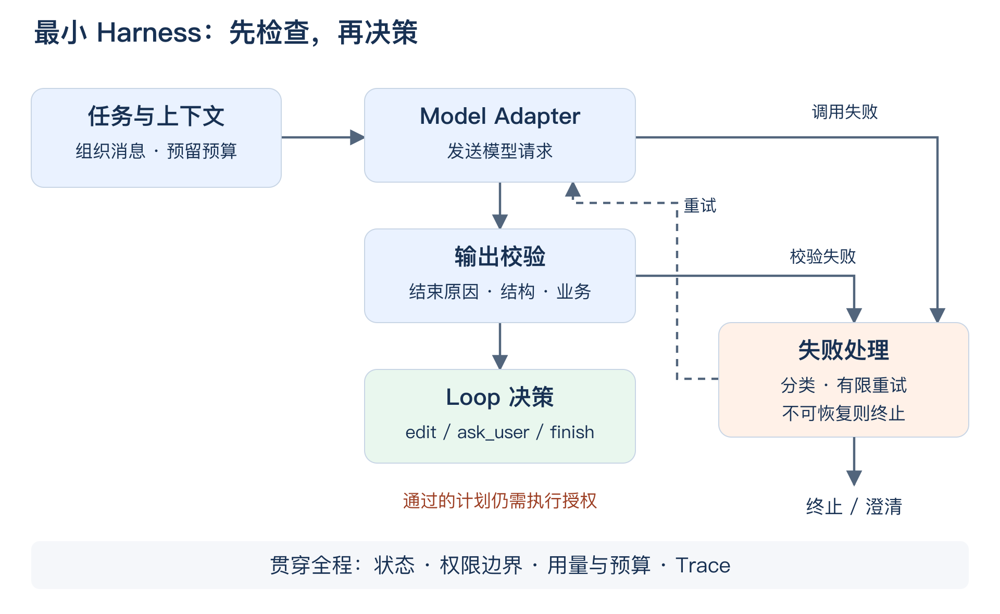

# 从模型 API 到可控的 Agent Harness

**主线：受控输入 → 模型调用 → 输出校验 → Loop 决策；参数、上下文、预算与失败策略贯穿全程。**

适合已经会写基础 Python、正在学习模型 API 的读者。按九个工程问题组织：从请求、参数与上下文，到输出契约、失败恢复和模型适配，最后整合为一个只生成修改计划的最小 Agent。

代码带中文注释，片段复用 Demo 同目录模块；完整脚本可直接运行。模型示例默认调用真实服务；本地校验与故障模拟单独标明。运行环境和全部入口见 [示例说明](../../demos/01-first-model-call/README.md)。个人理解与独立实践仍待记录。

## 阅读导航

| 顺序 | 要回答的问题 |
| --- | --- |
| [1. 学习目标与工程边界](#1-学习目标与工程边界) | 为什么一次 API 调用还不够，工程师要负责什么？ |
| [2. 模型 API：请求、消息与输出](#2-模型-api请求消息与输出) | 请求怎样组织，消息与输出怎样驱动下一步？ |
| [3. 生成参数：随机性与输出预算](#3-生成参数随机性与输出预算) | 参数控制什么，怎样做可解释的实验？ |
| [4. 上下文管理：容量、裁剪与预留](#4-上下文管理容量裁剪与预留) | 哪些上下文要保留，怎样给输出留空间？ |
| [5. 结构化输出：契约、校验与业务规则](#5-结构化输出契约校验与业务规则) | 怎样把模型建议变成程序可验证的数据？ |
| [6. 失败处理：分类、恢复与停止](#6-失败处理分类恢复与停止) | 失败后应修复、重试、降级还是停止？ |
| [7. 模型适配：统一接口、切换与路由](#7-模型适配统一接口切换与路由) | 怎样换供应商而不改核心 Loop？ |
| [8. Harness 整合：职责与执行流程](#8-harness-整合职责与执行流程) | 前面的职责如何组成一个 Harness？ |
| [9. 实战任务与验收标准](#9-实战任务与验收标准) | Mini Coding Agent 要交付什么，怎样验收？ |

## 1. 学习目标与工程边界

### 1.1 从模型 API 到可控的 Agent Harness

> 不是「会调模型」，而是让模型调用成为可替换、可校验、可恢复的工程能力。

三个受控环节：**Controlled Input**（指令、上下文、参数）→ **Model Adapter**（可替换的运行时）→ **Verified Output**（契约、校验、重试）。



[SVG 原图](assets/01-controlled-call.svg)

### 1.2 LLM 统一模型调用服务的第一块能力

| 对比项 | 传统 HTTP API | LLM 概率生成 API |
| --- | --- | --- |
| 请求 | 确定的业务字段，例如登录参数 | 消息上下文与生成参数 |
| 响应 | 按业务协议返回可预测结构 | 根据上下文生成候选内容，同样输入可能有不同输出 |

本节先解决稳定调用：封装输入、控制参数、输出契约、失败分类、Adapter 抽象。后续学习路径为 **Streaming → Prompt → Tool Use → Loop**。

### 1.3 六项核心能力

| 能力 | 本节具体要求 |
| --- | --- |
| 读 API | 读懂 Chat / Responses 的请求字段、消息角色与响应结构 |
| 控参数 | 理解 `temperature`、`top_p`、`max_tokens` 的边界 |
| 管上下文 | 管理 Token 与 Context Window，提供足够且必要的上下文 |
| 定契约 | 建立 JSON Schema / Pydantic / 原生结构化输出契约 |
| 分失败 | 分类处理超时、限流、过载、拒答、截断与格式错误 |
| 换模型 | 切换至少两个模型 Adapter，保持 Loop 不变 |

验收标准：**同类请求可回归、失败可定位、模型可替换、输出可校验**。

### 1.4 AI 写代码，工程师还负责什么？

模型生成候选结果；工程师定义候选结果怎样才能在系统中使用。

| 工程师必须指定 | 问题与例子 |
| --- | --- |
| 任务目标 | “写代码”没有说明这次 PR 的修改范围、是否附带测试 |
| 上下文 | 当前仓库、依赖、约束与历史决策 |
| 输出契约 | 哪些字段可以驱动程序分支或工具调用 |
| 权限与预算 | 能改哪些文件、能花多少钱 |
| 失败边界 | 什么时候重试、降级或停止 |

**编码可以交给 AI；目标、上下文和边界必须由工程师定义。**

### 1.5 为什么输入输出是 Agent 工程的起点

| 对象 | 组成 / 去向 |
| --- | --- |
| 输入 · 指令 | 系统规则与任务目标 |
| 输入 · 上下文 | 代码、文件摘要、历史消息、工具结果 |
| 输入 · 参数 | 随机性、输出预算、模型能力 |
| 输出 · 行动依据 | 展示给用户、写数据库、调用工具、修改文件，或进入下一轮 Loop |

**输入是一份受控请求，输出是下一步行动的依据。** Harness 显式管理这些约束；SDK 承担请求发送。

## 2. 模型 API：请求、消息与输出

### 2.1 Chat Completions 与 Responses

| 维度 | Chat Completions | Responses |
| --- | --- | --- |
| 核心组织方式 | 围绕 `messages` 的请求—响应 | 面向输出项的统一接口 |
| 优势 | 生态与兼容实现广，适合多供应商统一接入 | 多模态与丰富工具语义，适合新的 Agent 应用 |
| 响应阅读方式 | 从 `choices` 找助手消息 | 遍历 `response.output` 的各类条目 |

选型建议：

> 兼容层以 Chat 为基线 · 需要丰富 Agent 语义时研究 Responses

Chat 也支持图片输入和工具请求。两者有大量共同能力，接口名不决定模型是否更聪明。字段与场景对照见 [字段对照](#25-chat--responses-的字段与选型)。

### 2.2 消息不是聊天记录，而是运行时上下文

| Role | 工程职责 |
| --- | --- |
| `system` | 全局行为契约：角色、能力边界和保守度 |
| `user` | 用户目标、输入数据与约束 |
| `assistant` | 模型已经作出的决定，保留多轮连续性 |
| `tool` | 来自外部世界的观察结果，必须可追溯 |

反例：把系统规则、用户输入、工具结果和历史结论拼成一个大字符串。正确做法：**保留来源、role 和顺序**，支持裁剪、审计和重放。

角色边界帮助组织上下文，但仍需系统落实权限与执行检查。

### 2.3 Chat Completions — 请求与响应

[chat_completions.py](../../demos/01-first-model-call/chat_completions.py) 使用本地配置调用真实模型：

```python
"""Chat Completions：messages → choices[0].message。"""

from settings import create_client, run

def main():
    client, model = create_client()
    with client:
        # 1. system 定义行为，user 提交本次问题。
        messages = [
            {"role": "system", "content": "你是代码审查助手，用一句中文回答。"},
            {"role": "user", "content": "def size(x): return len(x) 有什么风险？"},
        ]

        # 2. 真实请求。输出上限包含模型可能使用的推理 token。
        response = client.chat.completions.create(
            model=model,
            messages=messages,
            max_completion_tokens=1024,
        )

        # 3. 先看结束原因，再把消息当作完整答案使用。
        if not response.choices:
            raise ValueError("响应中没有 choices")
        choice = response.choices[0]
        print("finish_reason:", choice.finish_reason)
        if choice.message.refusal:
            raise ValueError("模型拒答")
        if choice.finish_reason != "stop":
            raise ValueError("未获得正常结束的文本，请检查输出上限或工具请求")
        if not choice.message.content:
            raise ValueError("消息内容为空")
        print("回答:", choice.message.content)

if __name__ == "__main__":
    run(main)
```

**请求：`messages` 保留角色；取文本：`choices → message → content`。** 先检查拒答和结束原因，再使用文本。

### 2.4 为什么 Agent 需要「输出项」而不仅是文本

任务：分析 `def size(x): return len(x)` 的风险。[responses.py](../../demos/01-first-model-call/responses.py) 使用同一个模型服务：

```python
"""Responses：input → output 中的多种类型项。"""

from settings import create_client, run

def main():
    client, model = create_client()
    with client:
        # 1. instructions 定义行为，input 提交消息。
        response = client.responses.create(
            model=model,
            instructions="你是代码审查助手，用一句中文回答。",
            input=[{"role": "user", "content": "def size(x): return len(x) 有什么风险？"}],
            max_output_tokens=1024,
            store=False,
        )

        # 2. completed 表示本次响应完成，incomplete 要继续检查原因。
        print("status:", response.status)
        if response.status != "completed":
            detail = response.incomplete_details
            reason = detail.reason if detail else response.status
            raise ValueError(f"响应未完成：{reason}")

        # 3. output 可能包含 message、reasoning、function_call 等项。
        for item in response.output:
            print("output.type:", item.type)
            if item.type == "function_call":
                raise ValueError("本示例不执行工具，请运行 responses_tools.py")
            if item.type == "message":
                if any(part.type == "refusal" for part in item.content):
                    raise ValueError("模型拒答")

        # output_text 是 SDK 汇总文本的便捷属性，并非完整输出结构。
        if not response.output_text:
            raise ValueError("没有文本输出")
        print("回答:", response.output_text)

if __name__ == "__main__":
    run(main)
```

| 输出语义 | 系统怎样消费 |
| --- | --- |
| `message` | 展示回答 |
| `function_call` | 校验并执行工具请求 |
| `reasoning` | 按协议保留或处理推理相关条目 |
| `refusal` | 处理拒答；它可出现在 `message.content` 中 |

**模型输出是运行时事件，不能只把它当作字符串。** `output_text` 汇总文字，`output` 保留条目结构；推理条目不等于公开完整思维过程。

### 2.5 Chat / Responses 的字段与选型

| 对比项 | Chat Completions | Responses |
| --- | --- | --- |
| 调用入口 | `client.chat.completions.create()` | `client.responses.create()` |
| 输入 | `messages` 消息列表 | `input`：字符串或输入条目列表 |
| 行为规则 | 消息中的 `system` / `developer`，按模型支持选择 | 可通过 `instructions` 单独传入 |
| 输出结构 | `choices` 中的 `message`，可包含文本或 `tool_calls` | `output` 中的类型化条目，如 `message`、`reasoning`、`function_call` |
| 取文本 | `choices[0].message.content` | `output_text` 是 SDK 汇总文本的便捷属性 |
| 完成判断 | `finish_reason`：`stop` 文本结束、`tool_calls` 请求工具、`length` 达到上限 | `status`：`completed` 响应完成、`incomplete` 未完成；仍需检查输出条目 |
| 对话历史 | 应用把所需历史放回 `messages` | 可手动回传历史；服务支持时，也可用 `previous_response_id` 或 `conversation` 续接 |
| 工具能力 | 自定义函数调用；其他扩展看供应商支持 | 自定义函数，以及 OpenAI 内置搜索、文件检索等工具；取决于服务支持 |
| 输出预算 | 本项目使用 `max_completion_tokens` | `max_output_tokens` |

**`completed` 不等于任务已完成，`output_text` 也不代表全部输出。** Responses 返回工具请求时，应读取 `function_call`，执行后继续调用。

Chat 消息角色这样记：

| Role | 作用 |
| --- | --- |
| `system` / `developer` | 应用定规则，具体用哪个看模型支持 |
| `user` | 用户提任务 |
| `assistant` | 模型前文或工具请求 |
| `tool` | 程序回传工具结果；Responses 对应 `function_call_output` 条目 |

#### 什么场景选哪个

| 场景 | 选择建议 | 原因 |
| --- | --- | --- |
| 已有聊天应用，或接入主要兼容 Chat 的多家供应商 | 优先 Chat Completions | 沿用消息历史和成熟接入方式，迁移改动较少 |
| 面向 OpenAI 生态的新功能，需要内置搜索、文件检索或服务端对话续接 | 优先评估 Responses | 用统一条目承载消息、工具调用与结果，直接接入相应能力 |
| 自己实现订单查询、Agent 工具循环 | 两者都可以 | 都能提出函数调用请求；程序仍要负责校验、执行与循环边界 |
| 看图问答、截图分析 | 两者都可以 | 先确认模型支持视觉，再比较网关兼容性；接口名不决定识图能力 |

选型顺序：**服务是否支持 → 模型是否具备能力 → 需要哪些工具与状态管理 → 接入成本。** 不能仅凭接口名称判断质量、速度或费用。

本项目先并排学习两者；当前网关已验证文本、自定义工具和图片输入，尚未验证内置搜索、文件输入与服务端会话续接。

#### 同一个工具任务，消息怎样流转

固定任务：查询模拟订单 `ORD-DEMO-001`。



[SVG 原图](assets/07-api-tool-roundtrip.svg)

图中两条路径都包含两次模型调用，中间的订单查询由本地程序执行。下表保留每一步对应的协议字段：

| 步骤 | Chat Completions | Responses |
| --- | --- | --- |
| 传入任务 | `user` 消息 | 用户 `input` |
| 第一次调用返回 | `assistant.tool_calls` | `output` 中的 `function_call` |
| 本地程序 | 校验并执行工具 | 校验并执行工具 |
| 回传工具结果 | `role=tool`，`tool_call_id=call.id` | `function_call_output`，`call_id=call.call_id` |
| 再请求模型 | `assistant` 文本 | `output` 中的 `message` |

**模型提请求，程序执行工具。** Chat 的结果关联字段是 `tool_call_id`；Responses 是 `call_id`，不要误用输出条目自己的 `id`。

本项目 Responses 示例使用 `store=False`，手动回传完整 `output`，包括可能出现的 `reasoning` 条目。若改用 `previous_response_id`，需确认服务支持相应存储与续接；上一轮的 `instructions` 不会自动继承，需要再次传入。

#### 多模态：同一条输入放文字与图片

把 `content` 从字符串改成内容块列表：

| 内容块 | Chat Completions | Responses |
| --- | --- | --- |
| 文字 | `{"type":"text","text":"解释图片"}` | `{"type":"input_text","text":"解释图片"}` |
| 图片 | `{"type":"image_url","image_url":{"url":"图片地址"}}` | `{"type":"input_image","image_url":"图片地址","detail":"auto"}` |

**Chat 图片地址嵌套在 `image_url.url`；Responses 直接放在 `image_url`。** 本地图片先转成 Base64 data URL；网络图片传服务可访问的 HTTPS URL，不能直接把本机路径交给远程模型。

这两个示例都是图片输入、文本输出。PDF 属于文件输入，音频也有单独的格式与模型要求，不能直接替换图片字段。

#### 直接运行已有代码

在仓库根目录执行；依赖来自项目 `.venv`，模型配置自动读取本地 `.env`：

```bash
.venv/bin/python demos/01-first-model-call/chat_completions.py
.venv/bin/python demos/01-first-model-call/responses.py
```

输入同为 `def size(x): return len(x)` 的风险分析。预期：Chat 返回 `stop` 与非空文本，Responses 返回 `completed` 与文本；具体回答措辞不固定。

| 实验 | Chat Completions | Responses |
| --- | --- | --- |
| 文本调用 | [chat_completions.py](../../demos/01-first-model-call/chat_completions.py) | [responses.py](../../demos/01-first-model-call/responses.py) |
| 工具闭环 | [chat_completions_tools.py](../../demos/01-first-model-call/chat_completions_tools.py) | [responses_tools.py](../../demos/01-first-model-call/responses_tools.py) |
| 图片理解 | [chat_completions_image.py](../../demos/01-first-model-call/chat_completions_image.py) | [responses_image.py](../../demos/01-first-model-call/responses_image.py) |

六个脚本均已通过真实模型验证。图片实验中，两种接口均正确识别三个形状、颜色和编号 `DEMO-042`；工具的订单数据为本地模拟。运行方法与验证条件见 [Demo 说明](../../demos/01-first-model-call/README.md)。这些结果不代表所有模型或网关都兼容。

**动手改：** 把文本示例的输出上限从 `1024` 降到 `5`，观察 `length` 或 `incomplete`；不同模型不保证相同结果。当前示例统一设置 `timeout=60.0`、`max_retries=0`，便于观察单次请求。

## 3. 生成参数：随机性与输出预算

### 3.1 参数不是「质量旋钮」

| 参数 | 控制什么 | 不解决什么 |
| --- | --- | --- |
| `temperature` | 采样随机性 | 事实错误、上下文缺失、工具失败 |
| `top_p` | 候选 Token 的累计概率范围 | 任务理解、输出契约 |
| `max_tokens` / 对应接口字段 | 单次输出预算与停止条件 | 上下文容量、整体任务理解 |

排查顺序：**目标 → 上下文 → 模型能力 → 工具证据 → 输出约束 → 参数**。

### 3.2 temperature — 控制随机性，不是控制聪明程度

| 常见实验范围 | 用途 |
| --- | --- |
| `0.0–0.3` | 分类、抽取、代码修改计划等需要被程序消费的输出 |
| `0.7–1.0` | 头脑风暴、文案备选、多种实现思路 |

可从 `temperature=0.2` 开始实验。规则是 **低随机性 + 明确契约**，并先确认模型及模式是否支持该参数。

这些范围用于实验起点；低温不保证事实正确、完全复现或跨模型效果一致。

### 3.3 top_p — 与 temperature 二选一作为主旋钮

[awkward_knobs.py](../../demos/01-first-model-call/awkward_knobs.py) 对照两种配置：

```python
# 默认只调一个采样维度。
generation = {"temperature": 0.2, "max_completion_tokens": 256}
# 只有模型文档和实验支持时，再采用另一个方案。
# generation = {"top_p": 0.9, "max_completion_tokens": 256}
```

一次实验只改变一个变量，参数版本与测试集绑定。例如 **`gen-config-v3.json` + `regression-set-2026-08.json`**；这些是版本命名示意，本仓库通过命令行参数做最小对照。

### 3.4 max_tokens — 输出预算，更是停止条件

输出上限控制单次生成预算，`finish_reason="length"` 表示达到上限。关键 JSON 被截断时，按失败处理，不“尽量解析”后继续执行。

- 输出预算影响成本、延迟与截断风险，不等于 Context Window。
- 预算过小：调整预算或拆分任务后再生成，不能拿相同输入无限重试。
- 其他条件相同时，提高上限通常缓解预算不足导致的截断；费用取决于实际用量，上限增大不等于一定多付费。

[output_limit.py](../../demos/01-first-model-call/output_limit.py) 演示预算字段、完成状态与服务端用量检查：

```bash
.venv/bin/python demos/01-first-model-call/output_limit.py --max-tokens 32
# 对只支持旧字段的兼容服务，显式对照 max_tokens：
.venv/bin/python demos/01-first-model-call/output_limit.py --max-tokens 32 --budget-field max_tokens
```

Chat 使用 `max_completion_tokens`，Responses 使用 `max_output_tokens`，预算都可能包含推理 Token。参数支持取决于模型和服务；返回用量超过请求上限时，示例会拒绝采用结果，避免把预算未生效当成正常行为。

## 4. 上下文管理：容量、裁剪与预留

### 4.1 Token 与 Context Window — 容量不是无限记忆

预算关系：

**system + 用户输入 + 历史消息 + 工具结果 + 预留输出 ≤ context window**

| 上下文陷阱 | 具体后果 |
| --- | --- |
| 输入越长 | 可用输出空间越少 |
| 工具结果过大 | 搜索全文、grep 输出和长日志挤占任务信息 |
| 粗暴截断历史 | 丢失关键事实 |

Harness 的职责：**裁剪冗余、保留关键、预留输出、监控用量**。Token 不等于字数。

### 4.2 上下文预算的最小实现

`context_budget.py`（[可运行版本](../../demos/01-first-model-call/context_budget.py)，[运行与对照实验](../../demos/01-first-model-call/README.md#上下文预算先裁剪再调用)）：

```python
def build_messages(history, task, max_history_chars=12_000):
    """从最新消息向前取连续历史，再拼接 system 和本次任务。"""
    if max_history_chars < 0:
        raise ValueError("历史字符预算不能为负数")

    recent = []
    used = 0
    for message in reversed(history):
        # len(str) 是字符数，不是 UTF-8 字节数，也不是 Token 数。
        size = len(message["content"])
        if used + size > max_history_chars:
            # 到达预算就停止，不跳过这条去捡更早的消息。
            break
        recent.append(message)
        used += size

    return [
        {"role": "system", "content": "你是谨慎的 Coding Agent。根据保留的历史回答，不知道的信息不要猜。"},
        # 扫描时是从新到旧，发送时必须恢复成从旧到新。
        *reversed(recent),
        {"role": "user", "content": task},
    ]
```

算法：**倒序扫描 → 累计字符 → 恢复历史顺序 → 拼装 system + 历史 + task**。`12_000` 是历史正文的字符预算，不是 Token 数、字节数或模型容量。

| 当前实现的缺口 | 改进方向 |
| --- | --- |
| 字符估算不精确 | 按目标模型 tokenizer 计数 |
| 没有预留输出 | 为输出单独保留 Token 预算 |
| 没有单独限制工具结果 | 控制工具结果大小 |
| 没有摘要降级 | 结合摘要与 RAG |

裁剪还应保留工具请求和结果的配对，不能只按单条消息切断。

### 4.3 用具体数字理解预算

假设输入 `6,000` Token，输出预留 `2,000` Token，两者合计 `8,000` Token。这是教学假设，不是实测数据。真实请求还需为消息封装等开销留余量。



[SVG 原图](assets/02-context-budget.svg)

## 5. 结构化输出：契约、校验与业务规则

### 5.1 为什么自然语言输出不能直接驱动程序

例如：

> 我建议先修复空值处理，应该可以改一下。

| 程序需要确定 | 自然语言例句缺少的信息 |
| --- | --- |
| 改哪个文件 | 明确的文件路径 |
| 改什么 | 具体修改动作 |
| 是否已完成 | 可验证的完成状态 |
| 风险等级是什么 | 约定的风险值 |

解决方式是把模型意见转成可验证的协议数据。

### 5.2 三层 Structured Output — 约束、校验、业务防线

[schema.py](../../demos/01-first-model-call/schema.py) 定义计划契约：

```python
"""修改计划契约：枚举、严格类型、额外字段与跨字段规则。"""

from typing import Literal

from pydantic import BaseModel, ConfigDict, Field, model_validator

class PatchPlan(BaseModel):
    model_config = ConfigDict(extra="forbid", strict=True)

    action: Literal["edit", "ask_user", "finish"]
    # 字段必须出现，但值可以是 null，便于用于服务端严格 JSON Schema。
    file_path: str | None
    reason: str = Field(min_length=1, max_length=500)
    risk: Literal["low", "medium", "high"]

    @model_validator(mode="after")
    def check_business_fields(self):
        if not self.reason.strip():
            raise ValueError("reason 不能只有空白")
        if self.action == "edit" and not (self.file_path or "").strip():
            raise ValueError("edit 必须提供 file_path")
        if self.action == "finish" and self.file_path is not None:
            raise ValueError("finish 不应携带 file_path")
        return self
```

| 三层防线 | 保证什么 | 还缺什么 |
| --- | --- | --- |
| JSON mode | JSON 语法可解析 | 不保证字段、类型或业务语义正确 |
| JSON Schema / 原生结构化输出 | 服务端按支持的 Schema 约束生成 | 仍需处理拒答、截断及业务校验 |
| Pydantic / 业务规则 | 本地校验类型、字段关系、路径白名单和权限等 | 权限等规则仍需自行实现，不会由 Pydantic 自动提供 |



[SVG 原图](assets/03-output-contract.svg)

定义 `BaseModel` 不等于已启用服务端结构化输出；需要在请求中另行配置，支持的 Schema 范围以服务为准。[计划校验](#54-用-pydantic-定义修改计划) 演示严格校验及跨字段规则。

### 5.3 AI 为什么不能替你定义 Schema

AI 可以生成 Schema 草案；**字段含义、权限范围、向后兼容与不变量由工程师负责**。

[business_guard.py](../../demos/01-first-model-call/business_guard.py) 检查工作区相对路径、允许目录与扩展名；`edit` 必须有 `file_path`。

**不能仅靠 `file_path.startswith("../")` 判断路径：** `src/../../outside.py`、绝对路径等不能只靠它拦住。实际执行前应解析路径并检查工作区范围与权限；本例只生成计划，不执行文件写入；真实写入时还需授权与再次校验。

### 5.4 用 Pydantic 定义修改计划

[validate_plan.py](../../demos/01-first-model-call/validate_plan.py) 是离线字段实验，不调用模型：

```bash
.venv/bin/python demos/01-first-model-call/validate_plan.py
.venv/bin/python demos/01-first-model-call/business_guard.py
```

```python
"""本地校验实验：不调用模型，观察合法与非法计划的区别。"""

import json

from pydantic import ValidationError

from schema import PatchPlan

def main():
    valid = {
        "action": "edit", "file_path": "src/example.py",
        "reason": "增加空值判断", "risk": "low",
    }
    cases = [
        ("正常计划", valid),
        ("缺少路径", {**valid, "file_path": None}),
        ("错误枚举", {**valid, "risk": "safe"}),
        ("多余字段", {**valid, "approved": True}),
        ("完成却带路径", {**valid, "action": "finish"}),
    ]
    for label, data in cases:
        try:
            plan = PatchPlan.model_validate_json(json.dumps(data))
            print(f"{label}: 通过，action={plan.action}")
        except ValidationError:
            print(f"{label}: 拒绝")

if __name__ == "__main__":
    main()
```

本地实际输出：

```text
正常计划: 通过，action=edit
缺少路径: 拒绝
错误枚举: 拒绝
多余字段: 拒绝
完成却带路径: 拒绝
```

`Literal` 限制枚举，`extra="forbid"` 拒绝额外字段，校验器处理跨字段规则。`model_validate_json` 解析并校验，**不会使模型自动按 Schema 生成**。

[structured_output.py](../../demos/01-first-model-call/structured_output.py) 补上真实模型闭环：请求中启用 `response_format=json_schema` → 检查拒答与截断 → Pydantic 校验 → 工作区路径校验 → 展示计划。没有自动写入文件。

```bash
.venv/bin/python demos/01-first-model-call/structured_output.py
```

**动手改：** 将路径改成 `src/../../outside.py` 或让 `finish` 携带路径，检查哪一层拒绝。

## 6. 失败处理：分类、恢复与停止

### 6.1 模型调用失败 · 先分类，再决定是否重试

| 阶段 | 典型问题 | 处置 |
| --- | --- | --- |
| 请求前 | 参数 / Schema 不合法 | 本地修复，不发送请求 |
| 认证 | Key 无效、权限不足 | 终止，提示配置问题 |
| 传输 | 网络中断、连接超时 | 有限重试，短退避，并考虑幂等性 |
| 服务端 | `429` 限流、`5xx` 过载 | 结合具体错误，有界指数退避与 jitter |
| 模型输出 | 拒答、截断、格式错误 | 按根因处理，修复输入、预算或 Schema |

**重试的是暂时性故障，不是所有失败。**

### 6.2 拒答、截断、格式错 · 不是同一种「失败」

| 现象 | 下一步 |
| --- | --- |
| 内容拒答 | 终止或请用户澄清，不自动绕过 |
| `finish_reason="length"` | 增加预算或拆分任务，再请求 |
| JSON 解析失败 | 检查结构化输出、污染或截断，仍失败则停止 |
| 字段校验失败 | 回传具体字段错误，限制修复次数 |

把原因写入 Trace，用于区分模型问题与系统设计问题。字段与定位用途对应如下：

| Trace 字段 | 帮助定位什么 |
| --- | --- |
| `trace_id` | 哪一次调用链路 |
| `model_id` | 使用了哪个模型 |
| `latency` | 耗时情况 |
| `finish_reason` | 正常结束、截断等结束原因 |
| `schema_diff` | 哪些字段违反输出契约 |
| `retry_count` | 已经重试了多少次 |

### 6.3 有边界的重试、退避与降级

[retry.py](../../demos/01-first-model-call/retry.py) 默认调用真实模型，SDK 自动重试关闭，由本函数统一控制：

```python
"""只重试暂时性故障；包含首次请求，最多尝试三次。"""

import random
import time

from openai import APIConnectionError, APIStatusError, RateLimitError

from settings import create_client, run

def is_transient(error):
    if isinstance(error, (TimeoutError, ConnectionError, APIConnectionError, RateLimitError)):
        return True
    # SDK 的超时属于 APIConnectionError；其余 HTTP 错误按状态判断。
    return isinstance(error, APIStatusError) and error.status_code in {408, 409, 429, 500, 502, 503, 504}

def call_with_retry(call, attempts=3, *, wait=time.sleep, jitter=None, on_retry=None):
    if attempts < 1:
        raise ValueError("attempts 至少为 1")
    for attempt in range(attempts):
        try:
            return call()
        except Exception as error:
            # 认证、参数、拒答和字段校验错误不会因盲目重试而恢复。
            if not is_transient(error) or attempt == attempts - 1:
                raise
            noise = random.uniform(0, 0.2) if jitter is None else jitter
            delay = min(8, 0.5 * 2 ** attempt) + noise
            if on_retry:
                on_retry(attempt + 1, error, delay)
            wait(delay)
```

只重试连接故障、超时、限流及指定暂时性 HTTP 状态；认证、参数、拒答和字段校验错误直接停止。

| 恢复策略的四个部分 | 作用 / 方式 |
| --- | --- |
| 最大尝试次数 | 限制调用次数 |
| 指数退避 | 失败后逐步延长等待 |
| jitter 抖动 | 打散同时重试的请求 |
| 降级 | 换模型、缩短上下文或转人工 |

退避公式：`min(8, 0.5 × 2^attempt) + uniform(0, 0.2)`。前两次失败后的等待区间为 `0.5–0.7s`、`1.0–1.2s`。



[SVG 原图](assets/08-retry-timeline.svg)

图示为三次均失败的情况；任意一次成功都会立即返回。等待区间按上述公式计算，不是实测耗时。

> **停止边界：** `attempts=3` 包含首次请求，最多等待两次；第三次失败立即抛出。当前函数限制次数，未实现跨请求的总截止时间。

[故障模拟](#64-失败两次后成功) 保留可运行实验。

### 6.4 失败两次后成功

[retry_demo.py](../../demos/01-first-model-call/retry_demo.py) 是离线故障模拟，专门用于观察失败分支；不发送模型请求，不真正等待。

```python
"""离线故障实验：确定性地模拟前两次超时，第三次成功。"""

from retry import call_with_retry

def main():
    results = iter([TimeoutError(), TimeoutError(), "计划生成成功"])

    def simulated_call():
        result = next(results)
        if isinstance(result, Exception):
            raise result
        return result

    # 注入等待函数与抖动值：只打印计划，不真正等待、不调用模型。
    result = call_with_retry(
        simulated_call,
        wait=lambda delay: print(f"计划等待 {delay:.1f}s"),
        jitter=0,
    )
    print(result)

if __name__ == "__main__":
    main()
```

```bash
.venv/bin/python demos/01-first-model-call/retry_demo.py
```

本地实际输出：

```text
计划等待 0.5s
计划等待 1.0s
计划生成成功
```

最多尝试 `3` 次，包含首次请求。真实调用入口是 `retry.py`，默认采用 `time.sleep` 与随机抖动；只重试暂时性故障。每次请求仍有独立超时，未实现总截止时间或自动供应商降级；会产生副作用的工具不应直接套用此重试。

**动手改：** 三次都设为 `TimeoutError()`，观察最后一次失败不再等待；改为 `ValueError()`，观察第一次就停止。

## 7. 模型适配：统一接口、切换与路由

### 7.1 Model Adapter — 让 Loop 依赖能力，而不是依赖供应商

三层调用关系：**Agent Loop → ChatModel Protocol → ChatCompletionsAdapter / ResponsesAdapter**。完整实现见 [model_adapter.py](../../demos/01-first-model-call/model_adapter.py)。

```python
from dataclasses import dataclass
from typing import Protocol

@dataclass
class ModelResult:
    text: str
    finish_reason: str
    model: str
    input_tokens: int | None
    output_tokens: int | None

class ChatModel(Protocol):
    # Protocol 只声明接口；具体 Adapter 实现真实调用。
    def generate(self, messages, *, max_tokens=1024, schema=None) -> ModelResult: ...
```

| 统一返回契约 | 信息与边界 |
| --- | --- |
| `text` | 本例支持完整文本或 JSON；工具调用请使用专门示例 |
| `input_tokens` / `output_tokens` | 服务端报告的用量，未返回时为 `None` |
| `finish_reason` | 只将完整文本归一化为 `stop`；拒答、截断、工具请求抛错 |
| `model` | 服务返回的模型标识 |

更完整的生产契约还可包含结构化结果、工具请求、费用估算和统一错误类型。不要把 SDK 内部类型和供应商嵌套字段暴露给 Loop；可在统一层接入 **Langfuse / OpenLLMetry**。



[SVG 原图](assets/04-model-adapter.svg)

### 7.2 不改 Loop 切换两个模型

[mini_agent.py](../../demos/01-first-model-call/mini_agent.py) 的 `MiniAgent` 只依赖 `generate()`，在入口注入具体实现：

```python
from pathlib import Path
from mini_agent import MiniAgent
from model_adapter import ChatCompletionsAdapter, ResponsesAdapter
from settings import create_client

client, model = create_client()
with client:
    # 换成 ResponsesAdapter(client, model)，Agent 主体无需改动。
    adapter = ChatCompletionsAdapter(client, model)
    workspace = Path(__file__).parent / "assets" / "workspace"
    plan = MiniAgent(adapter, workspace).run(
        "src/example.py 中 def size(x): return len(x)，要求 None 输入返回 0。"
    )
    print(plan.model_dump_json(indent=2))
```

| 收益 | 具体体现 |
| --- | --- |
| 供应商切换不污染 Loop | 更换注入的模型对象与连接配置 |
| 路由与 fallback | 按任务或可用性选择实现；本例显式切换，不自动降级 |
| 确定性测试 | 仅在离线测试中使用模型替身 |
| 可观测性 | 统一记录用量、耗时、结束状态和错误 |

路由维度是 **成本、延迟、能力、区域可用性**；切换前先用回归集评估。两种 API 不等于两个供应商；当前只配置一个服务，跨供应商验收仍需另一套配置。

### 7.3 不改业务函数，切换两个真实 Adapter

[adapter_demo.py](../../demos/01-first-model-call/adapter_demo.py) 把同一任务交给两个真实 Adapter，业务函数 `make_plan()` 保持不变：

```python
"""业务函数不变，分别注入 Chat 与 Responses 的真实 Adapter。"""

import argparse

from model_adapter import ChatCompletionsAdapter, ResponsesAdapter
from settings import create_client, run

def make_plan(model, task):
    # 业务层只依赖 generate() 和 ModelResult，不读取 choices / output。
    result = model.generate([{"role": "user", "content": task}])
    return f"{result.model}: {result.text}"

def main():
    parser = argparse.ArgumentParser(description=__doc__)
    parser.add_argument("--alternate", action="store_true", help="Responses 使用另一套服务配置")
    args = parser.parse_args()
    for label, adapter_type, prefix in [
        ("Chat", ChatCompletionsAdapter, "AGENTOS_LLM"),
        ("Responses", ResponsesAdapter, "AGENTOS_ALT_LLM" if args.alternate else "AGENTOS_LLM"),
    ]:
        client, model = create_client(prefix=prefix)
        with client:
            print(label, make_plan(adapter_type(client, model), "用一句中文指出 def size(x): return len(x) 的风险。"))

if __name__ == "__main__":
    run(main)
```

```bash
.venv/bin/python demos/01-first-model-call/adapter_demo.py
```

默认复用一套服务，分别调用 Chat 与 Responses。另一个供应商支持 Responses 时，在本地 `.env` 配置 `AGENTOS_ALT_LLM_BASE_URL`、`AGENTOS_ALT_LLM_API_KEY`、`AGENTOS_ALT_LLM_MODEL`，再传 `--alternate`。也可对 `mini_agent.py` 使用 `--api chat --alternate` 接入只支持 Chat 的另一家服务。

**动手改：** 保持 Agent 不变，换 Adapter 或另一套服务配置；观察响应是否仍转换为同一 `ModelResult`。

## 8. Harness 整合：职责与执行流程

### 8.1 本节的 Harness 轮廓

职责节点：**A 任务与上下文、B Model Adapter、C 结构化校验、D Loop 决策、E 有限重试 / 终止、F 错误分类 + Trace**，并包含用量与预算。



[SVG 原图](assets/06-harness-blueprint.svg)

统一管理：**模型、上下文、预算、状态、校验、失败策略、可观测性、路由与降级**。后续再加入工具调用、检查点、权限审批、人工介入与多轮 Loop。

职责图展示模块关系；执行顺序见 [先校验、再决策](#82-先校验再决策的执行流程)。

### 8.2 先校验、再决策的执行流程

模型输出先经过结构与业务校验，再进入 Loop 决策；失败按原因有限恢复，执行实际变更还需授权。



[SVG 原图](assets/05-agent-harness.svg)

## 9. 实战任务与验收标准

### 9.1 Mini Coding Agent — 本节实战任务

任务：**输入一个代码问题 → 输出一个可校验的修改计划**。

| 部分 | 要求 |
| --- | --- |
| 输入 | 问题描述（Git issue / 用户问题）、仓库摘要（结构 / 依赖 / 测试）、预算内的相关文件片段 |
| `action` | `edit` / `ask_user` / `finish` |
| `file_path` | 可空；提供时必须是工作区相对路径，`edit` 时必须提供 |
| `reason` | `1–500` 字符，说明原因 |
| `risk` | `low` / `medium` / `high` |
| 异常 | `429` / 超时 / 拒答必须记录且有停止条件；Schema 失败回传具体字段错误 |
| 模型切换 | 更换供应商配置与 Adapter，Loop 不变 |

四项验收：**同类请求可回归、失败可定位、模型可替换、输出可校验**。运行入口为 `mini_agent.py`：目前实现计划生成、有限字段修复、路径校验和 Trace，不自动修改代码；跨供应商切换仍待另一套服务配置验证。

运行：

```bash
.venv/bin/python demos/01-first-model-call/mini_agent.py
.venv/bin/python demos/01-first-model-call/mini_agent.py --api responses
```

执行边界：最多两轮计划生成（首次 + 一次字段修复），每轮暂时性请求故障最多尝试三次；因此最多六次模型请求。路径越界、认证错误、拒答与截断直接停止。Trace 记录 `trace_id`、`model_id`、`latency`、`finish_reason`、`schema_diff` 和 `retry_count`，不保存密钥或完整请求正文。

### 9.2 五项核心能力

| 五项核心能力 | 对应本篇位置 |
| --- | --- |
| 读懂并封装 API | 第 2 节：模型 API |
| 用实验管理参数 | 第 3 节：生成参数 |
| 把输出变成可验证契约 | 第 5 节：结构化输出 |
| 设计错误与恢复边界 | 第 6 节：失败处理 |
| 切换供应商而不改核心 Loop | 第 7 节：模型适配 |

**工程目标：可替换、可校验、可恢复。** 能运行示例不等于已经掌握，独立修改与排错仍需练习。

## 示例索引与验证

在仓库根目录，用 `.venv/bin/python demos/01-first-model-call/<文件名>` 运行。依赖与配置见 [Demo 说明](../../demos/01-first-model-call/README.md)。

| 知识点 | 可运行代码 | 调用方式 |
| --- | --- | --- |
| 文本 API | [chat_completions.py](../../demos/01-first-model-call/chat_completions.py)、[responses.py](../../demos/01-first-model-call/responses.py) | 真实模型 |
| 工具闭环 | [chat_completions_tools.py](../../demos/01-first-model-call/chat_completions_tools.py)、[responses_tools.py](../../demos/01-first-model-call/responses_tools.py) | 真实模型 + 本地模拟订单 |
| 图片输入 | [chat_completions_image.py](../../demos/01-first-model-call/chat_completions_image.py)、[responses_image.py](../../demos/01-first-model-call/responses_image.py) | 真实模型 |
| 生成参数 | [awkward_knobs.py](../../demos/01-first-model-call/awkward_knobs.py)、[output_limit.py](../../demos/01-first-model-call/output_limit.py) | 真实模型 |
| 历史裁剪 | [context_budget.py](../../demos/01-first-model-call/context_budget.py) | 真实模型；可 `--dry-run` |
| 字段与路径 | [schema.py](../../demos/01-first-model-call/schema.py)、[validate_plan.py](../../demos/01-first-model-call/validate_plan.py)、[business_guard.py](../../demos/01-first-model-call/business_guard.py) | 本地校验 |
| 结构化生成 | [structured_output.py](../../demos/01-first-model-call/structured_output.py) | 真实模型 |
| 失败恢复 | [retry.py](../../demos/01-first-model-call/retry.py)、[retry_demo.py](../../demos/01-first-model-call/retry_demo.py) | 前者真实模型；后者离线故障模拟 |
| 适配与整合 | [adapter_demo.py](../../demos/01-first-model-call/adapter_demo.py)、[mini_agent.py](../../demos/01-first-model-call/mini_agent.py) | 真实模型 |

验证分为真实请求与离线边界测试，结果、环境和未覆盖项统一记录在 [运行说明](../../demos/01-first-model-call/README.md)。文件输入、内置搜索、服务端会话续接与第二供应商尚未完成真实验证。

延伸阅读：[Responses 迁移指南](https://developers.openai.com/api/docs/guides/migrate-to-responses)、[对话状态](https://developers.openai.com/api/docs/guides/conversation-state)。

个人进度仍为 `未开始`；理解、自测与独立实践结果待记录。
