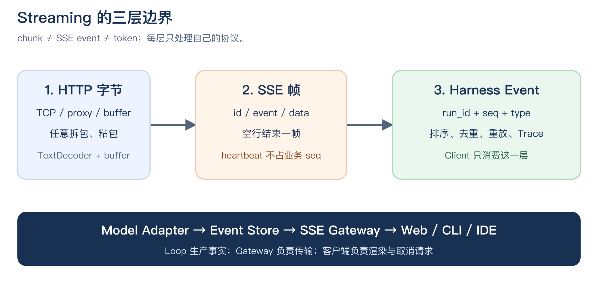
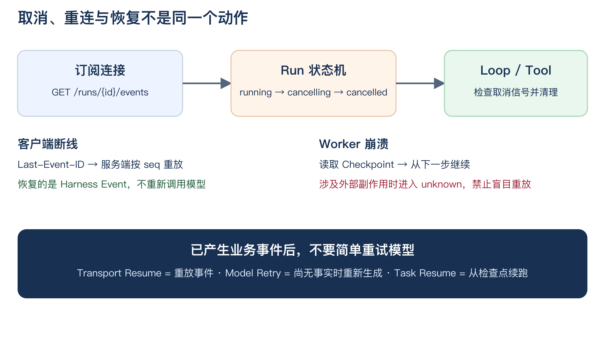

# Streaming：让 Agent 执行过程可见、可停、可续

**Streaming 不是打字机效果，而是 Agent Runtime 到交互层的事件通道。**

适合已经会写基础 Python、理解模型 API 和 Agent Loop 的读者。本篇沿用项目的独立技术笔记写法：先解释问题，再给协议、边界和最小代码；真实模型调用、离线测试和未验证能力分开记录。

配套代码：[demos/02-streaming](../../demos/02-streaming/README.md)。

## 阅读导航

| 主题 | 要回答的问题 |
| --- | --- |
| [1. 为什么需要 Streaming](#1-为什么需要-streaming) | 长任务为什么不能最后一次性返回？ |
| [2. 延迟与能力边界](#2-延迟与能力边界) | TTFT、生成耗时和 E2E 分别是什么？ |
| [3. Agent 事件流](#3-agent-事件流) | 为什么只传文本还不够？ |
| [4. 三层协议与 SSE](#4-三层协议与-sse) | 字节、SSE 帧和业务事件怎样分层？ |
| [5. 事件契约](#5-事件契约) | 怎样排序、去重、重放和演进事件？事件够不够，怎样对接 AG-UI？ |
| [6. Model Adapter](#6-model-adapter) | 怎样把供应商流转换成统一事件？ |
| [7. Run Store 与 Gateway](#7-run-store-与-gateway) | 怎样让任务脱离一次 HTTP 连接继续运行？ |
| [8. 客户端消费](#8-客户端消费) | Web、CLI、IDE 怎样共享一套事件协议？ |
| [9. 取消与终态](#9-取消与终态) | 断开连接、取消任务和强制终止有什么区别？ |
| [10. 失败恢复与 Checkpoint](#10-失败恢复与-checkpoint) | 什么时候重试、重放或从检查点续跑？ |
| [11. 最小 Agent Gateway](#11-最小-agent-gateway) | 如何把这些职责组装起来？ |
| [12. 实践与验收](#12-实践与验收) | 怎样证明流式系统真的可靠？ |

## 1. 为什么需要 Streaming

一次 Agent Run 可能经历：

1. 模型推理；
2. 文件检索；
3. 工具执行；
4. 根据工具结果再次推理；
5. 结果校验。

如果三十秒后只返回一个 JSON，用户看不到系统正在生成、排队、调用工具，还是已经卡住。流式事件把运行过程变成可观察的事实轨迹。

| 黑盒等待 | 事件流 |
| --- | --- |
| 只有最后一个响应 | 持续收到文本、工具、进度和终态 |
| 无法判断卡在哪里 | 可以看到当前阶段 |
| 只能刷新或关闭页面 | 可以纠偏、取消和重连 |
| 失败后没有中间事实 | 事件可以保存、审计和重放 |

**第一价值是可见性，不是更快的推理。**

## 2. 延迟与能力边界

### 2.1 三种延迟

| 指标 | 定义 | 主要影响因素 |
| --- | --- | --- |
| TTFT | 请求开始到首个非空文本 delta 到达客户端 | 排队、输入长度、Prefill、调度 |
| GEN | 首个文本 delta 到模型流结束 | 输出长度、Decode 速度、模型负载 |
| E2E | 用户操作到 Agent 最终完成 | 网络、模型、Loop、工具、存储、渲染 |

首个 SDK chunk 可能只有 role 元数据，甚至没有文本。TTFT 必须记录**首个非空 `text.delta`**，不能把第一个 chunk 当成用户真正看到内容的时间。

### 2.2 Streaming 能做什么

- 尽早展示已生成内容；
- 展示工具执行和长任务进度；
- 提供及时取消与纠偏；
- 让 Web、CLI、IDE 共用一套事件流；
- 让一次 Run 的事实可以审计和重放。

### 2.3 Streaming 不能做什么

- 不能让 GPU 推理自动变快；
- 不能解决过长上下文的 Prefill 成本；
- 不能替代 Event Store；
- 不能保证客户端断线后后台任务自动停止；
- 不能扩大模型的 Context Window。

三个概念要分开：

| 概念 | 解决的问题 |
| --- | --- |
| Streaming | 链路怎样把增量结果传出来 |
| Checkpoint | 任务状态怎样保存并续跑 |
| Context Window | 模型一次能处理多少输入和输出 |

## 3. Agent 事件流

聊天只传文本，Agent 还要传运行状态。工具执行期间可能没有文本，如果事件流只发送 delta，用户会再次看到“假卡顿”。

### 3.1 三类事件

| 类型 | 例子 | 用途 |
| --- | --- | --- |
| 数据面（Content） | `text.delta`、`message.completed` | 展示模型输出 |
| 过程面（Progress） | `tool.started`、`tool.completed`、`run.retrying` | 说明 Loop 走到哪一步 |
| 控制面（Terminal） | `run.completed`、`run.failed`、`run.cancelled` | 裁判唯一终态 |

控制面不能省略。只实现 `text.delta` 和 `tool.completed` 仍然只是聊天 Demo；必须有完成、失败和取消，系统才有明确的生命周期。

### 3.2 终态规则

- 一个 Run 只能有一个终态；
- 终态之后拒绝追加事件；
- 完成与取消发生竞态时，用服务端状态和事件序号裁决；
- `model.finished` 只表示模型流结束，不代表业务任务成功；
- `run.completed` 必须在业务校验通过后发布。



[SVG 原图](assets/09-streaming-stack.svg)

## 4. 三层协议与 SSE

### 4.1 三层不要混淆

| 层次 | 负责什么 | 常见误区 |
| --- | --- | --- |
| HTTP 字节 | TCP、代理、缓冲、任意拆包和粘包 | 假设一次 read 就是一条事件 |
| SSE 帧 | `id`、`event`、`data`、空行分隔 | 假设一帧等于一个 Token |
| Harness Event | `run_id`、`seq`、业务事件类型 | 把供应商 SDK 对象直接暴露给客户端 |

正确处理顺序是：

**bytes → UTF-8 增量解码 → SSE 帧 → JSON → RunEvent。**

一个模型 delta 可能包含多个 Token，也可能是空字符串；一个网络 chunk 可能半条 SSE，也可能包含多条 SSE。

### 4.2 SSE 的线格式

```text
id: 17
event: text.delta
data: {"run_id":"run_123","seq":17,"type":"text.delta","data":{"delta":"正在分析"}}

: heartbeat

```

规则：

- `Content-Type` 使用 `text/event-stream`；
- 空行结束一条 SSE 事件；
- `data` 通常承载 JSON 字符串；
- `id` 用于 `Last-Event-ID` 重连；
- heartbeat 是注释行，不进入业务事件，也不占用 `seq`；
- UTF-8 可能跨网络 chunk，必须使用增量解码器。

[sse_codec.py](../../demos/02-streaming/sse_codec.py) 提供 `encode_sse`、`encode_heartbeat` 和支持拆包的 `SSEParser`。

### 4.3 为什么优先 SSE

| 方案 | 适合 | 代价 |
| --- | --- | --- |
| 普通 JSON | 短请求、完整结果、批处理 | 没有增量反馈 |
| SSE | 模型输出、Run 状态、日志流 | 上行控制另走普通 HTTP |
| WebSocket | 双向高频事件、实时语音、协作 | 连接治理、重连和心跳更复杂 |

推荐拆成三个接口：

- `POST /runs`：创建后台任务，立即返回 `202 + run_id`；
- `GET /runs/{id}/events`：订阅并重放事件；
- `POST /runs/{id}/cancel`：请求取消任务。

**创建、订阅、控制分离，断开订阅不等于取消 Run。**

## 5. 事件契约

事件是内部协议，不是某个供应商的响应对象。

```python
from datetime import datetime, timezone
from typing import Any, Literal
from pydantic import BaseModel, Field

EventType = Literal[
    "run.started", "task.started", "text.delta",
    "tool.started", "tool.completed", "model.finished",
    "model.usage", "run.retrying",
    "run.completed", "run.failed", "run.cancelled",
]

class RunEvent(BaseModel):
    schema_version: Literal["1"] = "1"
    run_id: str
    seq: int = Field(ge=0)
    type: EventType
    created_at: datetime
    data: dict[str, Any] = {}
```

项目实现见 [events.py](../../demos/02-streaming/events.py)。

### 5.1 五个关键字段

| 字段 | 作用 |
| --- | --- |
| `schema_version` | 协议演进；未知版本可以降级 |
| `run_id` | 区分不同任务 |
| `seq` | Run 内排序、去重、重放、Trace |
| `created_at` | 重排事件、计算延迟 |
| `data` | 可演化的业务负载 |

`run_id + seq` 是 Run 内稳定事件位置。客户端遇到未知类型时应忽略或降级，不应因为一个新事件直接崩溃。

### 5.2 SSE 编码测试

编码器应该是纯函数，至少覆盖：

1. 中文 Unicode 往返；
2. data 中的换行；
3. 引号和反斜杠；
4. 空字符串 delta 不改变 seq；
5. 大于 64 KB 的单事件；
6. 任意字节拆分和多个事件粘连。

#### 解析器的行为与边界

> 2026-11-20 补充。以下结论来自阅读 [sse_codec.py](../../demos/02-streaming/sse_codec.py) 并实际运行验证。

`SSEParser` 要同时应对三种网络情况：

| 情况 | 例子 | 处理方式 |
| --- | --- | --- |
| 半个事件 | 只收到前半段 | 放进缓冲区，等后半段到达 |
| 多个事件粘连 | 一次收到事件、心跳、事件 | 按行处理，每遇到一个空行产出一个事件 |
| 中文被拆开 | 一个中文占 3 个字节，只收到其中 1 个 | 增量解码器先保留，字节到齐再合成 |

实测结果：在“好”字的 3 个字节中间切开，第一段返回空，第二段返回完整内容；两个事件加一个心跳粘连送入，得到 `seq` 为 2 和 3 的两个事件；未知事件类型返回空，不报错。

当前实现的边界：

1. `event:` 和 `id:` 行解析后没有被使用，事件完全由 `data` 里的 JSON 还原。这两行主要供浏览器 `EventSource` 使用。
2. 校验失败的事件（未知类型、多余字段、损坏 JSON）被静默丢弃，`seq` 上会留下空洞，解析器不检查连续性。代码注释写的“重连时由服务端按 seq 重放”，只在客户端用“最后一个成功解析的 seq”重连时才成立。
3. 只支持 `\n` 和 `\r\n` 换行。SSE 标准还允许单独的 `\r`，把编码结果里的 `\n` 全部换成 `\r` 后，解析不出任何事件。本项目编码器只输出 `\n`，对接第三方 SSE 服务时需要注意。
4. 连接结束时，没有空行收尾的事件被丢弃，`finish()` 固定返回空列表。
5. `retry:` 字段不处理，属于客户端连接层。

### 5.3 事件够不够：从当前 Demo 到完整事件体系

> 2026-11-20 补充。官方文档全文当时无法抓取，本节分“已核实”和“凭记忆”两类标注，见末尾核对清单。

#### 当前 Demo 的覆盖

`events.py` 定义了 11 种事件，实际被发出的只有 8 种。`tool.started`、`tool.completed`、`run.retrying` 已定义，但在 `demos/02-streaming` 里没有任何代码发出它们。原因是本阶段不接工具，也没有把重试写进事件。这是合理的，不需要提前补。

判断一种事件该不该加，看它有没有消费者：前端要不要据此改界面，存储要不要据此改状态，重放要不要据此恢复现场。没有消费者就不加。`RunEvent` 带 `schema_version`，并且 `extra="forbid"`，将来新增类型只需在 `EventType` 加一行，成本很低。

#### 两层事件的区别

| | `ModelStreamEvent` | `RunEvent` |
| --- | --- | --- |
| 文件 | `stream_model.py` | `events.py` |
| 产生者 | `OpenAIChatStreamingAdapter` | `RunStore.publish()` |
| 描述 | 模型流里的一个片段 | 一次运行里发生的一件事 |
| 字段 | `type`、`data` | 另有 `run_id`、`seq`、`created_at`、`schema_version` |
| 类型数量 | 3：`text.delta`、`model.finished`、`model.usage` | 11 |
| 校验 | 无（`dataclass`） | 有（pydantic） |
| 能否保存、重放 | 不能，没有序号 | 能，靠 `seq` |

转换发生在 `agent_loop.py`：只有 `text.delta`、`model.finished`、`model.usage` 三种模型事件被 `publish` 成 `RunEvent`，`run.started`、`task.started`、`run.completed` 等由 Loop 自己产生。`seq` 只能由业务层分配，因为模型适配器看不到整次运行。

#### 三家协议的共同设计

1. **开始、增量、结束三件套**：文字、工具参数、推理内容都会持续变长，拆成 start、delta、end，前端才知道什么时候创建和关闭一个 UI 元素。
2. **ID 关联**：增量事件带所属对象的 ID（`message_id`、`tool_call_id`），否则并发的多个块无法区分。
3. **快照加增量**：大对象先发完整快照（snapshot），之后只发变化部分（delta）。重连时直接发快照。
4. **生命周期**：运行有明确的开始和唯一的终态。
5. **保活**：`ping` 一类事件只防止代理断开连接，不携带业务内容。本项目已把心跳做成 SSE 注释行，不占用 `seq`。
6. **错误是事件**：流开始后 HTTP 状态码已经改不了，错误必须作为事件发出。

#### 完整事件分类（设计参考）

| 类别 | 事件 | 作用 |
| --- | --- | --- |
| 运行生命周期 | `run.started` / `run.completed` / `run.failed` / `run.cancelled` / `run.retrying` | 整次运行的起止与状态 |
| 步骤 | `step.started` / `step.finished` | 一次运行里的阶段，例如“检索”“生成”，用于进度展示 |
| 文本消息 | `message.started` / `text.delta` / `message.ended` | 带 `message_id`，前端据此创建、追加、关闭一个气泡 |
| 推理 | `reasoning.started` / `reasoning.delta` / `reasoning.ended` | 模型的思考内容，前端通常折叠显示 |
| 工具调用 | `tool.started` / `tool.args.delta` / `tool.args.ended` / `tool.result` / `tool.failed` | 带 `tool_call_id`，参数本身也是流式的 |
| 状态同步 | `state.snapshot` / `state.delta` | 共享状态；delta 常用 JSON Patch（描述“改哪个字段”的标准格式） |
| 消息同步 | `messages.snapshot` | 重连或恢复时一次性补全对话历史 |
| 人工介入 | `approval.required` / `approval.resolved` | 危险操作等待用户确认，运行暂停 |
| 用量与结束原因 | `model.usage` / `model.finished` | token 统计；`stop` 或 `length` |
| 扩展 | `custom` / `raw` | 自定义业务事件；透传底层原始事件，便于调试 |
| 保活 | 心跳 | 不占用 `seq` |

#### 对接 AG-UI

AG-UI（Agent User Interaction Protocol）是 Agent 后端到前端的开放事件协议。下表中的 AG-UI 事件名和字段**凭记忆**写成，实现前必须对照官方文档。

| AG-UI 事件 | 对应本项目事件 | 差距 |
| --- | --- | --- |
| `RUN_STARTED` | `run.started` | 需要 `thread_id`（会话 ID），目前只有 `run_id` |
| `RUN_FINISHED` | `run.completed` | 直接对应 |
| `RUN_ERROR` | `run.failed` | 直接对应 |
| `TEXT_MESSAGE_START` | 无 | 缺失，需要 `message_id` 和 `role` |
| `TEXT_MESSAGE_CONTENT` | `text.delta` | `data` 里只有 `delta`，没有 `message_id` |
| `TEXT_MESSAGE_END` | 无 | 缺失，可由 `model.finished` 触发 |
| `TOOL_CALL_START` / `ARGS` / `END` / `RESULT` | `tool.started` / `tool.completed` | 缺参数流式事件和 `tool_call_id` |
| `STATE_SNAPSHOT` / `STATE_DELTA`、`STEP_*`、`REASONING_*`、`CUSTOM` | 无 | 按需再加 |

没有直接对应的部分：

- `run.cancelled`：AG-UI 怎样表示取消，需要查文档。
- `seq` 与 `Last-Event-ID` 断线重放：这是本项目自己的可靠性机制，保留在传输层。
- `model.usage`：可能走 `CUSTOM` 或放进 `RUN_FINISHED`，需要核对。

**结论：不要把内部事件改成 AG-UI 格式，在网关出口加一个翻译层。**

```text
ModelStreamEvent → RunEvent（内部，含 seq）→ [AG-UI 翻译层] → SSE → 前端
```

这与 6.1 的原则一致：Adapter 只产出内部事件，不拼协议字符串。需要补的是内部事件里的 `thread_id`、`message_id`，以及文本的开始、结束事件。等做到多轮对话和工具调用时再加，成本最低。

#### 核对清单

已核实（来自搜索摘要）：

- AG-UI 共 25 种事件类型（[Kotlin SDK 文档](https://docs.ag-ui.com/sdk/kotlin/core/events)）。
- AG-UI 的 Runs and steps 包含 `RUN_STARTED`、`RUN_FINISHED`、`RUN_ERROR`、`STEP_STARTED`、`STEP_FINISHED`，另有 `TEXT_MESSAGE_*` 和 `MESSAGES_SNAPSHOT`（[spec 1.0](https://docs.ag-ui.com/spec/1.0/events)）。
- 文本消息、工具调用、推理消息遵循同一种“开始、内容、结束”或 chunk 的[流式模式](https://docs.ag-ui.com/spec/draft/basic/patterns/streaming)。
- Anthropic 的[流式事件](https://platform.claude.com/docs/en/build-with-claude/streaming)包括 `message_start`、`content_block_start`、`content_block_delta`、`content_block_stop`、`message_delta`、`message_stop`、`ping`、`error`，`thinking_delta` 已确认存在。
- OpenAI [Responses 流式事件](https://developers.openai.com/api/reference/resources/responses/streaming-events)使用 `response.output_text.delta`、`response.function_call_arguments.delta` 这类命名。

未核实（凭记忆，使用前确认）：

- AG-UI 各事件的完整字段、取消的表示方式、`THINKING_*` 与 `REASONING_*` 的取舍。
- OpenAI 流式事件的完整列表。
- 上面“完整事件分类”表是本项目的设计参考，不是任何一家协议的原文。

待办：在浏览器打开 [AG-UI 事件页](https://docs.ag-ui.com/concepts/events)，逐条核对后再动手改 `RunEvent`。

## 6. Model Adapter

### 6.1 Adapter 的边界

供应商流属于 Adapter；客户端只依赖 Harness Event。

```text
供应商 Chunk → ModelStreamEvent → RunEvent → SSE bytes
```

Adapter 不应该：

- 直接拼 SSE 字符串；
- 把供应商 SDK 类型泄露给客户端；
- 假设每个 chunk 都有 choices、文本或 usage；
- 把 `model.finished` 当成 `run.completed`。

### 6.2 OpenAI Compatible 流的边界

真实流式请求要关闭 SDK 自动重试，让 Harness 统一决定重试：

```python
stream = await client.chat.completions.create(
    model=model,
    messages=messages,
    stream=True,
    max_completion_tokens=1024,
    stream_options={"include_usage": True},
)
```

需要处理：

| 情况 | 处理 |
| --- | --- |
| `choices=[]` | 可能是末尾 usage-only chunk，不能索引 |
| `delta.content is None` | 可能只有 role 元数据，丢弃 |
| `finish_reason` 出现 | 产出 `model.finished`，交给业务层判断 |
| `usage` 出现 | 产出 `model.usage`，记录 Token 用量 |
| `length` / `content_filter` | 不能发布成功终态 |

[stream_model.py](../../demos/02-streaming/stream_model.py) 的 `normalize_chat_stream` 专门处理这些边界；[stream_chat.py](../../demos/02-streaming/stream_chat.py) 调用真实模型并测量三种延迟。

### 6.3 真实运行

```bash
.venv/bin/python demos/02-streaming/stream_chat.py
.venv/bin/python demos/02-streaming/stream_chat.py \
  --question "用一句话解释为什么 Streaming 不等于更快。" \
  --max-output-tokens 128
```

输出是 JSON Lines，每行一个内部事件；最后一行是 `metrics`。

## 7. Run Store 与 Gateway

### 7.1 为什么需要 Run Store

HTTP 连接可能断开，但 Agent 任务可能仍在执行。任务状态不能依赖一次请求生命周期。

内存版 Store 至少保存：

- Run 状态；
- 事件列表；
- 当前序号；
- 取消信号。

项目的 [run_store.py](../../demos/02-streaming/run_store.py) 用内存实现协议，之后可以替换为：

- PostgreSQL：保存不可丢失的事实事件，唯一键为 `(run_id, seq)`；
- Redis Stream / PubSub：提供实时通知；
- Gateway：从事实存储读取事件并推给客户端。

**通知可以丢，事实事件不能丢。**

### 7.2 Agent Loop 与 HTTP 解耦

Loop 负责：

- 调模型；
- 调工具；
- 产生统一业务事件；
- 检查取消信号；
- 发布唯一终态。

Loop 不负责：

- 拼 SSE 字符串；
- 管理浏览器连接；
- 决定 UI 怎样渲染。

项目的 [agent_loop.py](../../demos/02-streaming/agent_loop.py) 只依赖 `StreamingModel` 和 `RunStore`。

### 7.3 FastAPI Gateway

[gateway_fastapi.py](../../demos/02-streaming/gateway_fastapi.py) 提供三个接口：

| 接口 | 作用 |
| --- | --- |
| `POST /runs` | 创建 Run，后台启动 Loop，返回 `202` |
| `GET /runs/{run_id}/events` | 首先重放 `Last-Event-ID` 之后的事件，再持续发送新事件 |
| `POST /runs/{run_id}/cancel` | 设置取消状态，由 Loop 协作式停止 |

本地运行：

```bash
.venv/bin/python -m uvicorn gateway_fastapi:app --app-dir demos/02-streaming --reload
```

代码仍是教学版：内存 Store 不支持多进程共享，订阅使用轮询，生产环境应使用持久化 Store、通知机制、鉴权和连接生命周期治理。

## 8. 客户端消费

### 8.1 Web

EventSource 适合 `GET` 订阅。创建与订阅分离，刷新页面不会重新创建模型调用。

客户端负责：

- 展示文本；
- 按 `seq` 去重；
- 自动重连；
- 展示状态。

客户端不负责：

- 调模型；
- 执行工具；
- 解释业务决策；
- 自己重试模型。

每个 delta 都触发 Markdown 解析和 DOM 更新，会造成性能下降。网络层可以高频接收，UI 层用 `requestAnimationFrame` 或 debounce 合并刷新。

### 8.2 fetch + ReadableStream

需要 POST Streaming、Authorization Header 或更灵活的 body 时，使用 `fetch`。关键是：

```javascript
const reader = response.body.getReader();
const decoder = new TextDecoder("utf-8");
let buffer = "";

while (true) {
  const {value, done} = await reader.read();
  if (done) break;
  buffer += decoder.decode(value, {stream: true});
  // 只解析 buffer 中已经遇到空行的完整 SSE 帧。
}
```

`chunk ≠ event`。必须处理 UTF-8 边界、SSE 帧边界、一个 chunk 包含多条事件，以及最后未完成的 buffer。

### 8.3 Python CLI

[sse_cli.py](../../demos/02-streaming/sse_cli.py) 从 stdin 消费 SSE，只负责解析、去重和渲染：

```bash
.venv/bin/python demos/02-streaming/sse_cli.py < events.sse
```

CLI、Web 和 IDE 共享事件协议，差异只停留在渲染层和 IO 层。

## 9. 取消与终态

### 9.1 断开连接不等于停止生成

`eventSource.close()` 只停止当前客户端读取，后台可能仍在：

- 执行 Agent Loop；
- 生成模型输出；
- 运行工具；
- 产生外部副作用。

真正取消要调用 `POST /runs/{id}/cancel`，由服务端把取消信号传播到 Loop、模型和工具。

### 9.2 协作式取消与强制取消

| 方式 | 做法 | 代价 |
| --- | --- | --- |
| 协作式取消 | 每个 await 或副作用前检查 token | 安全、可保存、可清理 |
| 强制 Task Cancel | `Task.cancel()` 解除阻塞 | 中断点不确定，副作用可能未保存 |

不要用 `except Exception` 吞掉 `asyncio.CancelledError`。取消应该有自己的事件和终态。

### 9.3 取消状态机

不要直接 `running → cancelled`，而是：

```text
running → cancelling → cancelled
              ├──────→ completed
              └──────→ failed
```

`cancelling` 给资源释放和完成竞态留下明确状态。数据库更新应带条件，例如只允许 `created/running` 进入 `cancelling`。

### 9.4 工具取消更复杂

| 工具 | 例子 | 取消策略 |
| --- | --- | --- |
| 只读、可重试 | 搜索、读文件 | 停止等待，通常可重复 |
| 长任务、中等代价 | Shell、测试、构建 | 保存句柄，发送 SIGTERM，等待清理 |
| 不可逆副作用 | 邮件、支付、发布 | 查询外部状态，必要时人工确认，禁止盲目重放 |

超时只表示“没有收到结果”，不表示“动作没有发生”。需要建模 `unknown` 状态，并使用幂等 Key、Tool Call ID、外部状态查询和人工确认。



[SVG 原图](assets/10-cancel-recovery.svg)

## 10. 失败恢复与 Checkpoint

### 10.1 按失败阶段决定策略

| 阶段 | 已产生事实 | 策略 |
| --- | --- | --- |
| 连接 / 响应前 | 没有业务事件 | 可在白名单内有限重试 |
| 首事件之后 | 少量事实 | 不要盲目重新生成并拼接 |
| 持续事件之后 | 大量事实 | 查询状态，重放事件或从检查点继续 |

自动连接重试至少限制：

- `max_attempts`；
- `max_total_seconds`；
- 可重试错误白名单（DNS、网络、429、部分 5xx）；
- 指数退避和 jitter；
- Run 总预算。

认证、参数、Schema、内容拒答和已产生业务事件后，不应机械重试。项目的 [streaming_retry.py](../../demos/02-streaming/streaming_retry.py) 只在尚未产生不可重复事件前重试。

### 10.2 三种恢复不是一回事

| 恢复类型 | 目标 | 是否重新调用模型 |
| --- | --- | --- |
| Transport Resume | 恢复事件传输 | 否，从 Event Store 重放 |
| Model Retry | 连接 / 响应前重新生成 | 是，但尚无业务事实 |
| Task Resume | Worker 崩溃后继续任务 | 通常从 Checkpoint 进入下一步 |

断线续传恢复的是 Harness Event，不是模型 Token。客户端保存 `Last-Event-ID`，服务端查询 `seq > last_seq` 后按写入顺序重放。

### 10.3 Checkpoint

Streaming 解决“看得快”，Checkpoint 解决“任务崩溃后怎么继续”。检查点保存：

1. 当前 Loop 步骤 `loop_step`；
2. 已完成内容 `completed`；
3. 下一步位置 `next_cursor`；
4. 上下文摘要 `context_digest`；
5. 工具状态 `tool_state`；
6. 检查点版本 `version`。

检查点是可恢复状态，不是把全部历史重新塞回 Prompt，也不是可以直接提交的不完整 JSON、SQL 或 Patch。

项目的 [checkpoint.py](../../demos/02-streaming/checkpoint.py) 提供 Pydantic 模型和 JSON 保存 / 读取。

### 10.4 错误事件

客户端需要稳定错误码，而不是服务端堆栈：

```json
{
  "type": "run.failed",
  "data": {
    "code": "TOOL_TIMEOUT",
    "stage": "tool.completed",
    "retryable": false,
    "hint": "需要确认是否属于 unknown 状态"
  }
}
```

服务端可以保存原始异常、Trace ID、Request ID、Token 用量和工具副作用状态，但不能把 API Key、Prompt 原文或内部堆栈推给客户端。

## 11. 最小 Agent Gateway

最小链路：

```text
Client
  ↓ POST /runs
Run Store ← Agent Loop ← Model Adapter ← Model Provider
  ↓                         ↓
SSE Gateway ← Event Store ← RunEvent
  ↓
Web / CLI / IDE
```

职责对位：

| 组件 | 负责 | 不负责 |
| --- | --- | --- |
| Model Adapter | 归一化模型流 | UI 输出 |
| Agent Loop | 执行任务、工具和状态 | HTTP |
| Tool Runtime | 工具执行和副作用状态 | 页面展示 |
| Event Store | 保存、排序、重放事件 | 重新执行 |
| SSE Gateway | 编码、心跳、订阅 | 业务决策 |
| Client | 展示、去重、取消请求 | 模型解析 |

核心原则：**Loop 不懂 HTTP，Client 不懂模型 SDK，Gateway 不决定任务是否完成。**

## 12. 实践与验收

### 12.1 运行代码

```bash
# 真实模型流式调用，输出 JSON Lines 和三种延迟。
.venv/bin/python demos/02-streaming/stream_chat.py

# 只验证协议、状态和恢复边界，不调用模型。
.venv/bin/python -m unittest discover -s demos/02-streaming/tests -v

# 运行 FastAPI Gateway（需要安装 Demo 直接依赖）。
.venv/bin/python -m uvicorn gateway_fastapi:app --app-dir demos/02-streaming --reload
```

### 12.2 必须覆盖的边界

- SSE 编码和 UTF-8 拆包；
- 多事件粘连；
- `seq` 顺序和重复事件；
- usage-only chunk；
- 空 delta 和非正常 finish reason；
- 断线重连；
- 取消传播；
- 完成 / 取消竞态；
- 流失败恢复；
- Checkpoint 恢复；
- 工具副作用进入 `unknown`。

### 12.3 课后项目

把一次性模型调用升级为 Streaming Agent Gateway：

1. 定义 `RunEvent`；
2. 实现 SSE 编解码；
3. 抽象 `StreamingModel`；
4. 接入真实模型 Adapter；
5. 实现 Run Store；
6. 实现 Agent Loop；
7. 暴露创建、订阅、取消接口；
8. 写 CLI 或 Web 客户端；
9. 增加拆包、去重、断线、取消和失败测试；
10. 接入持久化 Store 与 Checkpoint。

验收标准：

- 首个非空 delta 可观测；
- Client 不依赖模型 SDK；
- Run 只有一个终态；
- 取消信号可传播；
- 断线恢复不重新调用模型；
- 失败事件含稳定错误码；
- Checkpoint 可读取并继续下一步；
- Trace 能定位模型、工具、重试、重连和取消。

## 示例索引

| 能力 | 代码 | 方式 |
| --- | --- | --- |
| 真实流式调用 | [stream_chat.py](../../demos/02-streaming/stream_chat.py) | 真实模型 |
| 事件契约 | [events.py](../../demos/02-streaming/events.py) | 本地 |
| SSE 编解码 | [sse_codec.py](../../demos/02-streaming/sse_codec.py) | 本地 |
| 供应商流归一化 | [stream_model.py](../../demos/02-streaming/stream_model.py) | 本地 + 真实入口 |
| Run Store | [run_store.py](../../demos/02-streaming/run_store.py) | 本地内存 |
| Agent Loop | [agent_loop.py](../../demos/02-streaming/agent_loop.py) | 本地 |
| SSE Gateway | [gateway_fastapi.py](../../demos/02-streaming/gateway_fastapi.py) | FastAPI，可选依赖 |
| CLI 消费 | [sse_cli.py](../../demos/02-streaming/sse_cli.py) | stdin |
| 取消 | [cancellation.py](../../demos/02-streaming/cancellation.py) | 本地 |
| 恢复 | [streaming_retry.py](../../demos/02-streaming/streaming_retry.py)、[checkpoint.py](../../demos/02-streaming/checkpoint.py) | 本地 |
| 边界测试 | [tests/test_streaming.py](../../demos/02-streaming/tests/test_streaming.py) | 8 项离线测试 |

## 验证记录

2026-11-19，项目 Python 3.13.9、OpenAI SDK 3.51.0，使用本地配置调用真实模型一次。返回了多个 `text.delta`、`model.finished`、`model.usage`，并输出 TTFT、GEN、E2E 三项指标。随后实际启动 FastAPI Gateway，完成 `POST /runs → GET /events`，收到 `run.completed`，并用 `last_event_id` 继续重放。具体数值随网络和模型变化，不作为固定性能承诺。

离线测试覆盖 SSE Unicode / 拆包、未知事件降级、单一终态、完成与截断失败、协作取消、Checkpoint 往返、连接重试边界和供应商 chunk 归一化。第二供应商、真实 FastAPI 部署、断线网络恢复、真实工具取消和外部副作用状态尚未实测。

个人进度仍为 `未开始`；能够运行示例不等于已经掌握，需要独立改变输入、断开连接并解释结果。

